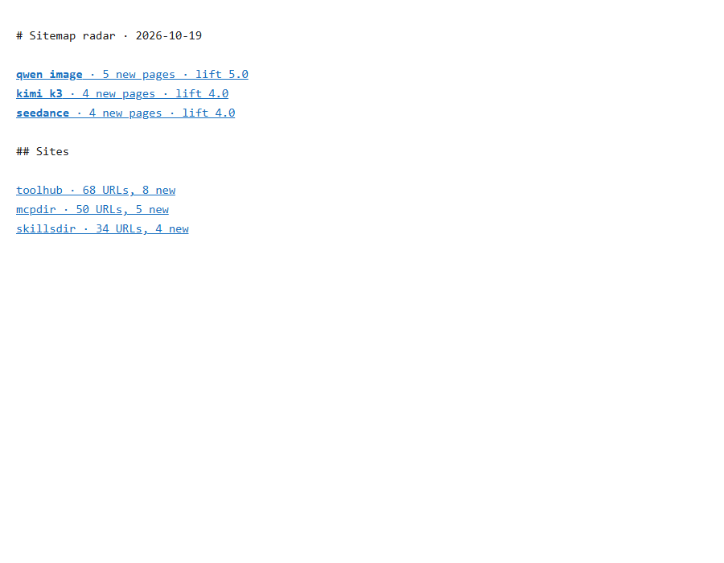
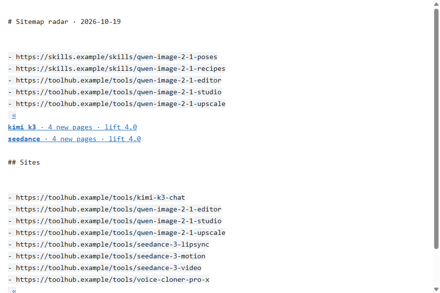

<div align="center">

# stretch-radar

**See what AI tool and MCP directories added since yesterday, one line per new name, click to see the pages.**

[new-term-radar](https://github.com/zhuyansen/new-term-radar)'s sitemap signal, read in parallel, written as Ted Nelson's stretchtext in [cc-stretch](https://github.com/pro-vi/cc-stretch)'s `{{short|long}}` markup. One Python file, no dependencies.

Works with **Claude Code** and **Codex**.

 

</div>

## Quick start
```bash
git clone https://github.com/Dodai0419/stretch-radar && cd stretch-radar
python stretch_radar.py --demo --html radar.html
```
```
# Sitemap radar · 2026-10-19

{{**qwen image** · 5 new pages · lift 5.0|
- https://skills.example/skills/qwen-image-2-1-poses
- https://toolhub.example/tools/qwen-image-2-1-editor
...
}}
{{**kimi k3** · 4 new pages · lift 4.0|
...
```
`radar.html`, closed and with two lines opened:

| closed | opened |
|-|-|
|  |  |

On real sites (run it daily; the first run only stores each sitemap):
```bash
python stretch_radar.py --config sites.example.json --state state --md radar.md --html radar.html
```

## The problem
- New AI names show up in tool and MCP directories days before keyword tools list them, but nobody reads twelve sitemaps a day.
- new-term-radar reads them one site after another, sleeping between sites even when they are on different hosts.
- Its term list can change from one run to the next on the same data: the nested-term cleanup depends on Python's string hash order.

## The solution
| Idea | Fixes |
|------|-------|
| **Sitemap diff ported from new-term-radar** (same terms, lift, stop words, snapshot files) | Words 3+ new URLs share, ranked by how unusual they are for that site |
| **One thread per host, the same `pause` between requests to a host** | Wall time is the slowest host, not the sum of every site and pause |
| **Ties broken longest phrase first** | "qwen image" is kept and "qwen" / "image" are dropped, every run |
| **cc-stretch `{{short|long}}` output + a self-contained HTML viewer** | Skim the names; open one to see the exact new pages |

## Use with Claude Code
```bash
/plugin marketplace add Dodai0419/stretch-radar
/plugin install stretch-radar@stretch-radar
```

## Use with Codex (ChatGPT)
```bash
git clone https://github.com/Dodai0419/stretch-radar && cp -r stretch-radar/skills/* ~/.codex/skills/
```
Or copy `AGENTS.md` to your project root.

## Benchmarks
new-term-radar `e2d33c3`, cc-stretch `d929ef3`, Windows 11, Python 3.11.1.

| | original | this repo |
|-|-|-|
| live first run on 4 sites (ai-bot.cn, dang, aitoptools, futurepedia; pauses 3/2/2/2 s), 2 runs | 22.7 s, 14.7 s (`sitemaps.diff`) | 4.6 s, 6.1 s (`diff`), same URL counts per site (5,068 / 7,698 / 11,834 / 1,329) |
| sleep time built into that run | 6 s (pauses between sites) | 0 s (four different hosts) |
| same terms on the same data across hash seeds | no: 6 seeds gave 5 different lists | yes (longest phrase first) |
| lines of code | 572 (sitemaps.py 103 + terms.py 138 + snap.py 15 + parse.ts 316) | 311 (diff + parser + markdown + HTML viewer) |
| dependencies | 0 (Python) / Node + Claude Code for the stretch renderer | 0 |

Network times vary with the sites; the fixed part of the gap is the 6 s of pauses. Parity, both unit tests: on the bundled two-day fixtures `diff` returns exactly what new-term-radar returns under `PYTHONHASHSEED=1` (the ordering its docstring describes); `parse` returns the same segments as cc-stretch's `parse.ts` (run in Node) on 14 inputs covering nesting, repeated keys, code spans and fences. The other radar signals (X, Hugging Face, GitHub breakout, keyword table, review) are not included.

## Inspired by
- [zhuyansen/new-term-radar](https://github.com/zhuyansen/new-term-radar): the sitemap signal, term scoring and snapshot layout (MIT, ported).
- [pro-vi/cc-stretch](https://github.com/pro-vi/cc-stretch): the stretchtext markup and parser (MIT, ported).

## Roadmap
- [ ] Hugging Face trending signal in the same page
- [ ] RSS feed of each day's page

## License
MIT
